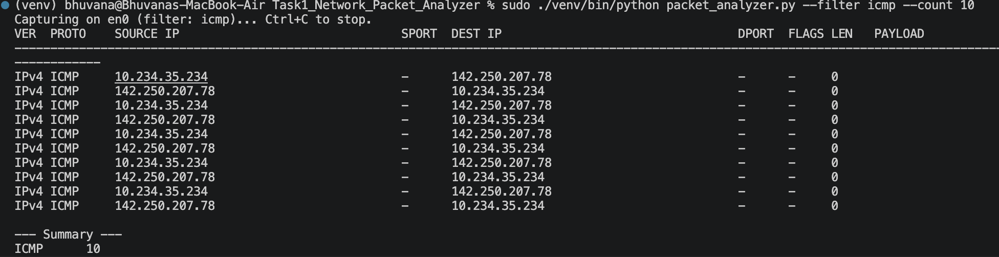

# Network Packet Analyzer

A simple Python tool that listens to network traffic on my computer and shows the important details of each packet in a neat table. It can also save the results to a CSV file.

This is Task 1 of my CodSoft Cyber Security Internship.

## What it does

When you use the internet, your data travels in small pieces called packets. This tool captures those packets and shows:

- Who sent the packet (source IP)
- Who it is going to (destination IP)
- The type of packet (TCP, UDP, ICMP and so on)
- The ports used
- TCP flags (like ACK or SYN)
- How much data it carries, and a small safe preview of that data

## Technologies used

- Python 3: the programming language
- Scapy: a library that captures packets and reads them
- argparse: lets the user give options from the command line
- csv: saves the results to a file

## What you need

- A Mac with Python 3.9 or newer
- The Scapy library (listed in `requirements.txt`)
- Permission to capture packets: run the tool with `sudo`

## How to install

```bash
git clone https://github.com/Bhuvana15-hub/CODSOFT_TASKSNO.git
cd CODSOFT_TASKSNO/Task1_Network_Packet_Analyzer
python3 -m venv venv
source venv/bin/activate
pip install -r requirements.txt
```

## How to use

Run these from the Terminal (not the VS Code Run button, because it does not use `sudo`).

```bash
# See all options
python packet_analyzer.py --help

# Capture 10 ping (ICMP) packets
sudo ./venv/bin/python packet_analyzer.py --filter icmp --count 10

# Capture DNS traffic and save it to a CSV file
sudo ./venv/bin/python packet_analyzer.py --filter "udp port 53" --count 5 --output dns.csv
```

| Option              | What it does                                                | Default |
| ------------------- | ----------------------------------------------------------- | ------- |
| `-i`, `--interface` | Which network interface to listen on                        | `en0`   |
| `-c`, `--count`     | How many packets to capture (0 = until Ctrl+C)              | 30      |
| `-f`, `--filter`    | Capture only certain traffic, like `icmp` or `tcp port 443` | none    |
| `-o`, `--output`    | Save results to this CSV file                               | none    |

## Example output

The addresses below are example addresses, not real ones.

```
VER  PROTO    SOURCE IP        SPORT  DEST IP          DPORT  FLAGS LEN   PAYLOAD
-------------------------------------------------------------------------------
IPv4 ICMP     192.0.2.10       -      198.51.100.20    -      -     0
IPv4 ICMP     198.51.100.20    -      192.0.2.10       -      -     0

--- Summary ---
ICMP      2
```



## How it works

1. `sniff()` from Scapy listens on the network and calls my function for every packet it catches.
2. My function checks which layers the packet has (IPv4, IPv6, TCP, UDP) before reading any details. This stops the program from crashing on packets like ARP that do not have those layers.
3. The details are collected in one dictionary. The same dictionary is used to print the table, count the protocols, and write the CSV, so the code is not repeated.
4. Protocol numbers (like 6 or 17) are changed to names (TCP, UDP) using a lookup table.
5. At the end, a short summary shows how many packets of each protocol were captured.

## Security features

- **Network data is untrusted.** The payload preview shows only normal printable characters, so strange characters cannot mess with the terminal.
- **CSV safety.** If a packet's text starts with `=`, `+`, `-` or `@`, a quote is added so Excel does not treat it as a formula.
- **Safe output file.** The CSV is created so only the owner can read it, and the tool will never overwrite an existing file.
- **Input checks.** The packet count and the interface name are checked before capturing starts.
- **No shell commands.** The filter is given to the capture library, not to the shell.
- **Clear errors.** A wrong interface, wrong filter, missing permission or bad file path shows one simple message instead of a long error.
- **Private data stays private.** `.csv` and `.pcap` files are blocked in `.gitignore`, so real network data is never uploaded.

## Testing

| Test                | Command                            | Result                                     |
| ------------------- | ---------------------------------- | ------------------------------------------ |
| Ping packets        | `--filter icmp --count 10`         | 10 ICMP rows and a summary                 |
| DNS packets         | `--filter "udp port 53" --count 5` | UDP rows, domain names visible             |
| Save to CSV         | `--output file.csv`                | Header row plus one row per packet         |
| File already exists | Same `--output` twice              | Second run refuses to overwrite            |
| File permissions    | `ls -l file.csv`                   | `-rw-------` (owner only)                  |
| Wrong interface     | `--interface fake0`                | Clear error with a list of real interfaces |
| Wrong filter        | `--filter "banana banana"`         | Clear error message                        |
| Wrong output path   | `--output /nonexistent/x.csv`      | Clear error message                        |

## Results

The tool captured and showed live IPv4 and IPv6 traffic correctly. I could see TCP conversations with ACK and PSH flags, ping requests and replies, and DNS questions with readable website names. HTTPS data looked like random characters because it is encrypted, but the IP addresses, ports and flags were still visible.

## Limitations

- ARP and other non-IP packets are shown on screen but not saved to the CSV.
- With a wrong filter, the table header prints before the error message.
- HTTPS data is encrypted, so only the headers can be seen.
- The payload preview can show readable text from unencrypted traffic like HTTP.
- Tested on macOS only.

## Problems I faced and what I learned

- **`sudo` could not find Scapy.** `sudo` uses the system Python instead of my virtual environment. I fixed it by running `sudo ./venv/bin/python`.
- **Crash on IPv6 and ARP packets.** They do not have an IPv4 layer, so reading `packet[IP].src` would fail. I fixed it by checking the layers first.
- **Long errors for wrong input.** A fake interface and a wrong filter showed long error messages. I tested these cases and added proper error handling.
- **What I learned:** encryption hides the data but not who is talking to whom, DNS questions can be read by anyone on the network, and data from the network should never be trusted.

## Legal and ethical note

Only capture traffic on networks you own or have permission to monitor. Capturing other people's traffic without permission can be illegal. This tool is only for learning.

## Future improvements

- Save packets to a `.pcap` file that Wireshark can open
- Show live traffic statistics
- Decode DNS questions and answers
- Work on Linux and Windows

## Conclusion

This project captures live network traffic and shows it in a clear table, while handling files and errors safely. It helped me understand network layers, protocols, ports, and how to write secure code for a tool that handles untrusted data.
