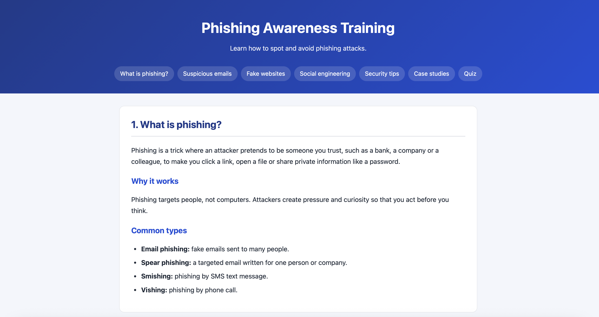
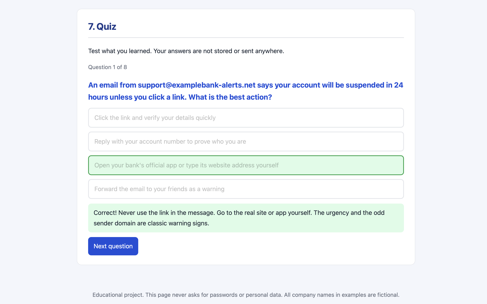

# Phishing Awareness Training

A small website that teaches people how to recognize and avoid phishing attacks. It has short lessons, real case studies and a quiz with instant feedback.

This is **Task 2** of my CodSoft Cyber Security Internship.
**Live demo:** [https://bhuvana15-hub.github.io/CODSOFT_TASKSNO/Task2_Phishing_Awareness/](https://bhuvana15-hub.github.io/CODSOFT_TASKSNO/Task2_Phishing_Awareness/)

## Objective

Phishing tricks people, not computers. This project explains how phishing works and how to spot it, in simple language that anyone can follow.

## What is inside

1. **What is phishing?** Definition, why it works, and the main types (email, spear phishing, SMS, voice).
2. **Spotting suspicious emails.** Warning signs, plus a fake example email with numbered red flags.
3. **Fake login pages and websites.** How to read a web address, look-alike domains, and why the padlock is not proof of safety.
4. **Social engineering techniques.** Urgency, fear, authority, greed, curiosity and trust.
5. **Practical security tips.** Good habits, MFA, password managers, and what to do if you clicked.
6. **Case studies.** Two real incidents with lessons and sources.
7. **Quiz.** 8 multiple-choice questions with an explanation after each answer and a final score.

## Technologies used

- **HTML:** the structure and content
- **CSS:** the design, including a layout that adapts to small screens
- **JavaScript:** the quiz
- No frameworks and no libraries, so there is nothing to install

## Project structure

```
Task2_Phishing_Awareness/
├── index.html       # content and page structure
├── style.css        # design
├── quiz.js          # quiz logic
├── screenshots/     # pictures for this README
└── README.md
```

## How to run

1. Download or clone the repository.
2. Open `Task2_Phishing_Awareness/index.html` in any web browser.

No installation or internet connection is needed.

## Screenshots





## How it works

- **Menu links:** each link points to a section by its `id`, and `scroll-behavior: smooth` makes the page glide to it.
- **Quiz data:** the questions are stored in a JavaScript array. Each question has its text, the options, the number of the right answer and an explanation.
- **Quiz logic:** the script shows one question at a time. After you click an answer, the buttons lock, the right and wrong answers are coloured, and an explanation appears. At the end it shows your score as a percentage.
- **Colours and spacing:** CSS variables keep the colours in one place.

## Security and safety

- **No data collection:** the page never asks for a password or personal information. The quiz stores nothing and sends nothing anywhere.
- **Safe text display:** the quiz writes text with `textContent`, not `innerHTML`, so text is always shown as plain text and can never run as code (this prevents cross-site scripting).
- **Safe external links:** links to sources open in a new tab with `rel="noopener noreferrer"`.
- **No real phishing content:** the fake email and web addresses use a made-up company called ExampleBank. They are shown as plain text and are not clickable, so nothing in the project can be used to trick anyone.
- **No scripts from other websites:** everything runs from the project's own files.

## Testing

| Test                                               | Result |
| -------------------------------------------------- | ------ |
| Every menu link jumps to the right section         | Passed |
| Styles load from `style.css`                       | Passed |
| Correct answer turns green, wrong answer turns red | Passed |
| Explanation shows after each answer                | Passed |
| A second click on an answer is ignored             | Passed |
| Final score and percentage are correct             | Passed |
| "Try again" restarts the quiz at 0                 | Passed |

## Case study sources

- Twitter attack, July 2020: AP report (via TechXplore) and Help Net Security.
- Google and Facebook invoice scam, 2013 to 2015: NPR and CNBC.

The links are in the Case studies section of the page.

## Limitations

- The quiz has a fixed set of 8 questions in a fixed order.
- The content is in English only.
- Company names and web addresses in the examples are made up. They are not linked, but a similar name could exist by coincidence.
- Phishing methods change over time, so the content should be reviewed regularly.

## What I learned

- Phishing works by creating pressure, so the best defence is to pause and check.
- The address bar matters more than how a page looks. Always read a domain from right to left.
- Never use the link in a suspicious message. Go to the real site yourself.
- Even large technology companies were fooled, so phishing is not about being careless.
- Text that comes from outside should be shown with `textContent`, not `innerHTML`.

## Future improvements

- Randomize the question order and add more questions
- Add a timer and a leaderboard
- Add a short SMS and QR-code phishing section
- Add a Hindi version

## Conclusion

This project turns a security topic into a short, practical lesson with real examples and a quiz. It helped me understand how social engineering works and how to explain security to people who are not technical.
